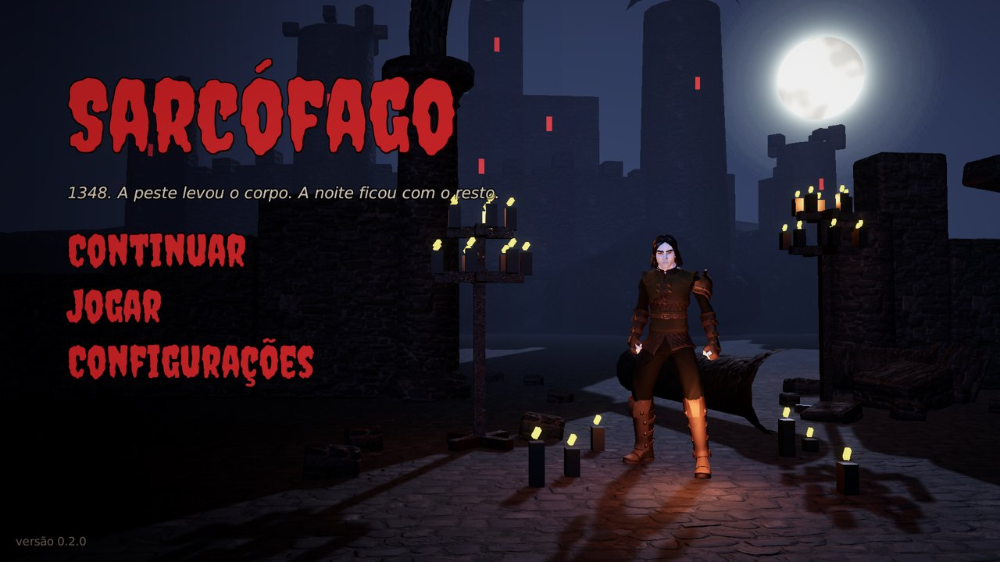

# Sarcófago

Jogo de ação sombrio para Android. É 1348, a Peste Negra varre a Europa, e Elias morre da peste e desperta vampiro num velho sarcófago de madeira. Dez regiões, dez chefões vampiros e o Conde Drácula no fim.

## Jogar no navegador

**[Abrir a página do jogo](https://josephsantiagos.github.io/sarcofago-download/)**: dá para jogar no navegador do computador, sem instalar nada, ou baixar para Android.

## Baixar

**[Baixar a versão mais nova (Sarcofago.apk)](https://github.com/josephsantiagos/sarcofago-download/releases/latest/download/Sarcofago.apk)**

São cerca de 460 MB. As versões anteriores e o que mudou em cada uma ficam em [Releases](https://github.com/josephsantiagos/sarcofago-download/releases).

## Instalar no celular

1. Abra o link acima no celular e baixe o `Sarcofago.apk`.
2. Toque no arquivo baixado. O Android pede para permitir **"instalar apps desconhecidos"** para o navegador; permita.
3. Se o Play Protect avisar que o app é desconhecido, toque em **"Instalar mesmo assim"**. É uma versão de teste, fora da Play Store.
4. Para atualizar, baixe a versão nova e instale por cima: a campanha continua.

**Precisa de:** Android 8 ou mais novo, celular de 64 bits. Recomendado: 4 GB de RAM.

**Celular fraco ou esquentando?** No menu, vá em **Configurações**: Gráficos **Baixo** e **30** quadros por segundo.

## Créditos

- Modelos e animações: [Quaternius](https://quaternius.com) (CC0).
- Texturas e modelos de cenário: [Poly Haven](https://polyhaven.com) (CC0).
- Ícones: [game-icons.net](https://game-icons.net) (CC BY 3.0), de Lorc, Delapouite e outros autores.
- Fonte do título: Creepster, de Font Diner (SIL Open Font License 1.1).

O código do jogo não fica aqui: este repositório só guarda os instaladores de teste.
